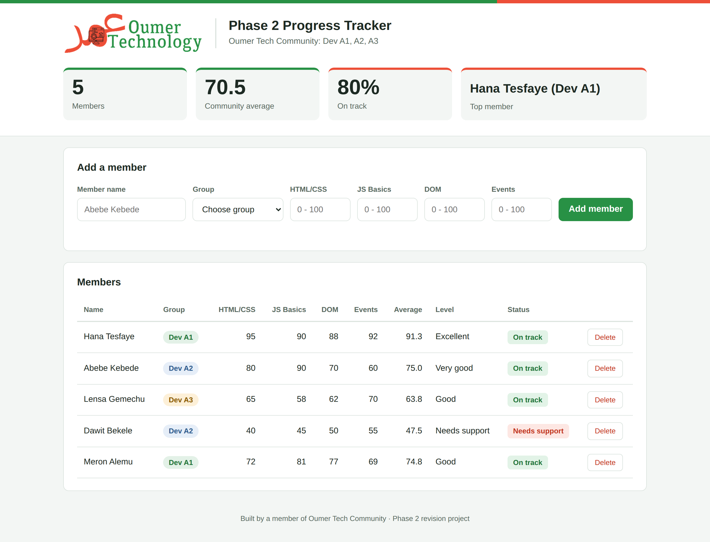

# Phase 2 Revision Project: Progress Tracker

Oumer Tech Community · Dev A1, A2, A3

---

## 1. What i will build

A one-page web app that tracks how our community members are doing in Phase 2.

With your finished app, a group admin can:

- **Add a member** with their name, group (Dev A1, A2 or A3) and scores for 4 tasks: HTML/CSS, JS Basics, DOM and Events.
- **See each member's result:** average, level, and a green **On track** or red **Needs support** badge.
- **See the community at a glance:** total members, community average, % on track and the top member.
- **Type names any way:** `"  abebe   KEBEDE "` is saved as `"Abebe Kebede"`.
- **Get clear error messages** for empty or wrong input, which disappear as soon as you fix them.
- **Delete a member,** and every number updates.

> The HTML and CSS are already done. **Your job is the JavaScript** in `starter/script.js`.

---

## 2. How to start

1. **Unzip** this folder.
2. **Open the `starter` folder in VS Code.**
3. **Open `index.html` in your browser.** The easiest way is to right-click it and choose **Open with Live Server**.
4. **Open the browser console** with `F12` (or `Ctrl + Shift + I`), then click the **Console** tab. You will test everything here.
5. **Open `script.js`** and start at the top. Every step is a `TODO` comment that tells you what to write and which class note to read.

**What else is in the folder:**

| Folder | Use it for |
| --- | --- |
| `design/` | Pictures of the finished app (desktop, mobile, error message). Compare your work with these. |
| `resources/` | All Phase 2 class notes, plus `RESOURCES.md`, which shows which note to read for each step. |
| `PROJECT-BRIEF.pdf` | The full list of features, rules and bonus challenges. |

> **Stuck?** Read the `TODO` again, `console.log` your variables to see what they really hold, then ask in your Dev group with your code and the console error.

---

## 3. Level and status rules

Every member's **average** decides their level and status. Use these exact rules so everyone's app gives the same results.

| Average | Level | Status badge |
| --- | --- | --- |
| 90 and above | Excellent | 🟢 On track |
| 75 to 89.9 | Very good | 🟢 On track |
| 60 to 74.9 | Good | 🟢 On track |
| 50 to 59.9 | Fair | 🟢 On track |
| Below 50 | Needs support | 🔴 Needs support |

**Check your app with these examples:**

| Scores | Average | Level | Status |
| --- | --- | --- | --- |
| 95, 90, 88, 92 | 91.3 | Excellent | On track |
| 80, 90, 70, 60 | 75 | Very good | On track |
| 40, 45, 50, 55 | 47.5 | Needs support | Needs support |

If your app shows these results, your logic is correct.
